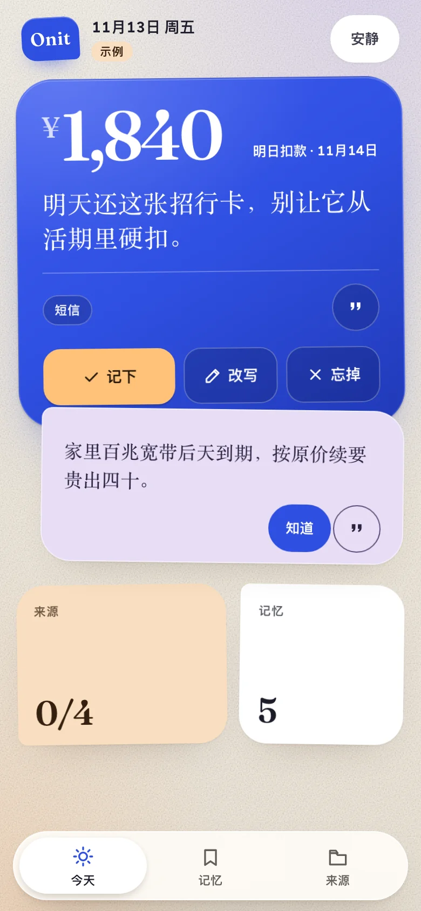

# Onit

[中文版](README.zh-CN.md)

Onit is a personal adviser that runs on your own device. You give it the material you want followed and the goals you want tracked. It works in the background and comes back with results: a short observation each day, drawn from your material; reviews of your goals, on a schedule you enable; briefs prepared from your sources, with the original quotes kept beside them; and small single-purpose apps generated from a sentence. All your data sits in one SQLite file. No account, no telemetry.

It is built the other way round from a notes app: the record exists so the adviser has something to read. Every result carries the quote it came from.

<div align="center"></div>

## What it does

- A daily voice: one short observation from the material you keep, with the source quote one tap away and three actions: keep, rewrite or drop.
- Goals with progress entries. The review runs only after you enable it.
- Briefs prepared from the sources you selected, with the exact quotes kept beside the result.
- Small apps generated from a sentence, stored as artifacts and rerunnable with a new request.
- Discovery, dossier, proposal and weekly report views over the same local data.

Everything lives in `memory.sqlite` inside the data directory. The server listens on loopback and asks for a bearer token on every request.

## Requirements

- Go 1.26 or newer.
- An OpenAI-compatible chat completions endpoint. HTTPS addresses are accepted anywhere; HTTP only on localhost or private network addresses; an address must not embed credentials or query parameters. Background work calls the endpoint without an API key, so point it at a local model, or at a local proxy that holds your key.

## Quick start

Build the server and create a data directory:

```bash
cd backend
go build -o ../adviser .
../adviser init -dir ../data
```

`init` writes the owner credential to `data/credentials/owner-a.token` and never prints it. Start the server with the web client attached:

```bash
../adviser serve -dir ../data -web ../web -endpoint http://127.0.0.1:11434/v1/chat/completions -model your-model
```

Open `http://127.0.0.1:7341/?live=1&t=<token>`, replacing `<token>` with the contents of the credential file. The client stores the token from the address bar in local storage, so later visits do not need it.

To load the synthetic demo set:

```bash
../adviser seed -dir ../data -base http://127.0.0.1:7341 -token-file ../data/credentials/owner-a.token
```

Without `?live=1` the web client shows its built-in demo data and makes no requests. `backend/` holds the Go server, its tests and its fixtures; `web/` holds the static client.

## Commands

```text
adviser serve|issue|android-bridge|app-job|init|doctor|seed|backup|restore|goal-review|goal-review-worker
```

Run a command with no arguments to see its flags.

- `init -dir <new dir>` creates a data directory, a manifest and one owner credential.
- `issue -db <file>` creates another owner token and prints it once, or writes it with `-token-file`.
- `serve -dir <dir> [-web <dir>] [-listen 127.0.0.1:7341] [-endpoint <url> -model <name>]` starts the API and, with `-web`, the client.
- `doctor -dir <dir>` checks a data directory.
- `backup -dir <dir> -out <new dir>` copies a data directory with a manifest and per-file digests. `restore` reads it back.

## HTTP API

Every route lives under `/v1/` and needs `Authorization: Bearer <token>`. Responses are JSON. The full route table is in `backend/service.go`; the web client uses these:

- `GET /v1/artifacts/{date}`
- `POST /v1/apps/make`
- `POST /v1/apps/update`
- `GET /v1/model`
- `POST /v1/voice-act`

## Privacy

The server binds to a numeric loopback address only, writes no telemetry, and makes no network request except to the model endpoint you configure. The data directory is created with mode 0700 and credentials with 0600. `backup` copies the directory as plain files, so store the copy somewhere you trust.

## Tests

```bash
cd backend
go test ./...
```

Some tests skip unless their environment variables are set: `ONIT_REAL_MODEL_ENDPOINT`, `ONIT_REAL_MODEL_NAME` and `ONIT_REAL_MODEL_KEY` for the real-model check, and `ONIT_LOCK_*` for the lock-window probe.

## Status

Early. The interface is in Chinese; expect the API to change. The Android app ships as a signed APK under Releases (currently demo2, Android 8.0 or newer); the app's source is not part of this repository.

## License

MIT. See `LICENSE`. Third-party components and their licenses are listed in `THIRD-PARTY-NOTICES.md`.
