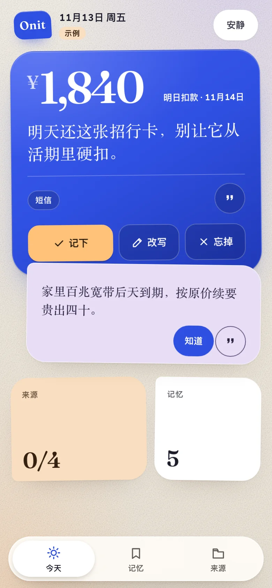

# Onit

中文版 · [English](README.md)

Onit 是装在你自己设备上的私人顾问。你把自己选定的材料和目标交给它，它在后台替你干活，把结果拿回来：每天一条从材料里得出的短观察，按你开启的节奏做的目标回顾，连同原文引语一起备好的简报，还有用一句话生成的单一用途小应用。数据都在一个 SQLite 文件里，没有账号，没有遥测。

它和笔记类工具的方向相反：记录是为了让顾问有东西可读。每条结果都带着它所依据的原文。

<div align="center"></div>

## 它做什么

- 每天一条短观察，来自你保存的材料；点一下能看到原文引语，可以记下、改写或忘掉。
- 目标与进展记录；回顾只在你开启之后才运行。
- 从你选定的来源准备简报，确切的引语保留在结果旁边。
- 用一句话生成小应用，作为制品保存，换个请求可以重新生成。
- 同一份本地数据上的发现、档案、提案与周报视图。

所有内容都在数据目录的 `memory.sqlite` 里。服务器只监听本机回环地址，每个请求都要带令牌。

## 环境要求

- Go 1.26 或更新版本。
- 一个 OpenAI 兼容的 chat completions 接口。接受任何 HTTPS 地址；HTTP 只接受本机或内网地址；地址里不能带凭据或查询参数。后台调用接口时不带 API 密钥，请指向本地模型，或指向替你保管密钥的本地代理。

## 快速开始

构建服务端，创建数据目录：

```bash
cd backend
go build -o ../adviser .
../adviser init -dir ../data
```

`init` 把持有者凭据写进 `data/credentials/owner-a.token`，不会打印内容。带着网页客户端启动服务：

```bash
../adviser serve -dir ../data -web ../web -endpoint http://127.0.0.1:11434/v1/chat/completions -model your-model
```

打开 `http://127.0.0.1:7341/?live=1&t=<token>`，把 `<token>` 换成凭据文件的内容。客户端会把地址栏里的令牌存进 local storage，之后再访问不用再带。

载入内置的演示数据：

```bash
../adviser seed -dir ../data -base http://127.0.0.1:7341 -token-file ../data/credentials/owner-a.token
```

不带 `?live=1` 时，网页客户端显示内置的演示数据，不发任何请求。`backend/` 里是 Go 服务端、测试和测试数据；`web/` 里是静态客户端。

## 命令

```text
adviser serve|issue|android-bridge|app-job|init|doctor|seed|backup|restore|goal-review|goal-review-worker
```

不带参数运行任一命令，可以看到它的全部参数。

- `init -dir <新目录>` 创建数据目录、清单和一份所有者凭据。
- `issue -db <文件>` 再建一个所有者令牌并打印一次，或用 `-token-file` 写入文件。
- `serve -dir <目录> [-web <目录>] [-listen 127.0.0.1:7341] [-endpoint <url> -model <名称>]` 启动接口；带 `-web` 时同时提供网页客户端。
- `doctor -dir <目录>` 检查一个数据目录。
- `backup -dir <目录> -out <新目录>` 连同清单和逐文件摘要复制数据目录；`restore` 把它读回来。

## HTTP 接口

所有路由都在 `/v1/` 之下，需要 `Authorization: Bearer <令牌>`，响应是 JSON。完整路由表在 `backend/service.go`；网页客户端用到这些：

- `GET /v1/artifacts/{date}`
- `POST /v1/apps/make`
- `POST /v1/apps/update`
- `GET /v1/model`
- `POST /v1/voice-act`

## 隐私

服务器只绑定数字形式的本机回环地址，不写遥测，除你配置的模型接口外不发任何网络请求。数据目录以 0700 权限创建，凭据以 0600 权限创建。`backup` 把目录按原样复制成普通文件，请把副本存放在你信任的地方。

## 测试

```bash
cd backend
go test ./...
```

有些测试只在设置了环境变量时才运行：真实模型检查用 `ONIT_REAL_MODEL_ENDPOINT`、`ONIT_REAL_MODEL_NAME` 和 `ONIT_REAL_MODEL_KEY`，锁窗口探测用 `ONIT_LOCK_*`。

## 状态

早期阶段，接口可能变化。安卓应用以签名 APK 发布在本仓库的 Releases 页（目前为 demo2，需 Android 8.0 以上）；应用的源码不包含在本仓库里。

## 许可证

MIT，见 `LICENSE`。第三方组件及其许可证见 `THIRD-PARTY-NOTICES.md`。
